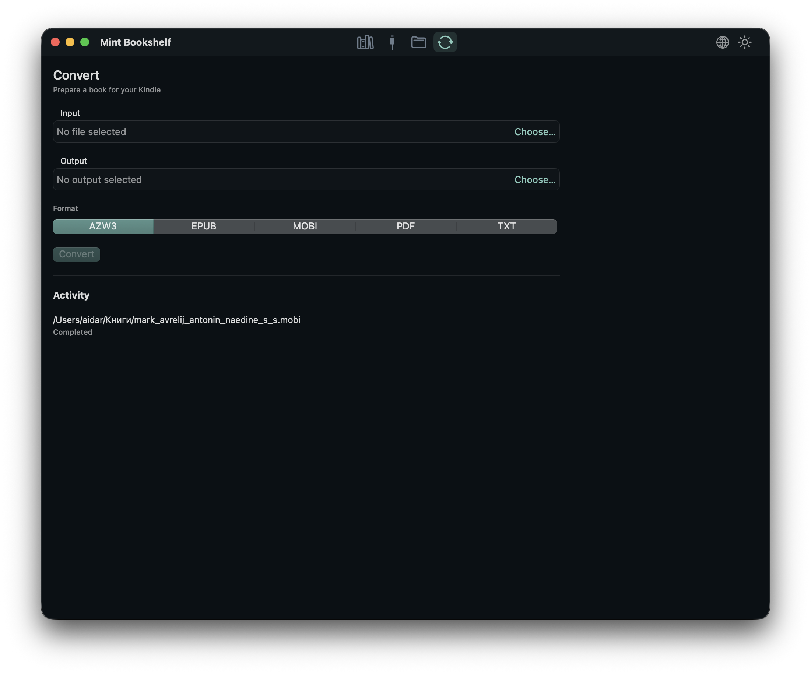

<div align="center">
  
  <h1>Mint Bookshelf</h1>
  <p><strong>Un hogar nativo en macOS para tu biblioteca y tus Kindle por USB.</strong></p>

  <p>
    <a href="README.md">English</a> ·
    <a href="README.ru.md">Русский</a> ·
    <a href="README.es.md">Español</a> ·
    <a href="README.pt.md">Português</a> ·
    <a href="README.zh.md">中文</a> ·
    <a href="README.fr.md">Français</a>
  </p>

  <p>
    <a href="../../releases"></a>
    
    
    
    
    
  </p>
</div>

> **Biblioteca local. Acceso USB directo. Sin nube y sin ruido.**
>
> Mint Bookshelf reúne tus libros, tu Kindle y el trabajo diario con archivos en una sola aplicación de macOS.

## Funciones

- **Biblioteca** — portadas, búsqueda, detalles y orden por título, autor o fecha de incorporación.
- **Kindle** — árbol de carpetas MTP, subida, descarga, movimiento, copia, renombrado y borrado.
- **Archivos** — explorador local estilo Finder con copiar, pegar, arrastrar y operaciones en segundo plano.
- **Conversión** — con Calibre, progreso y cancelación.
- **Aspecto** — temas claro y oscuro, seis idiomas de interfaz y comportamiento nativo de macOS.
- **Comodidad** — sin barras de acciones: menús contextuales, atajos y una vista limpia de lista y detalles.

## Capturas

<div align="center">
  
  <br>
  <sub>Biblioteca — temas claro y oscuro</sub>
</div>

## Qué hace

- Analiza solo la carpeta elegida y la recuerda entre lanzamientos.
- Extrae portadas de EPUB, MOBI, AZW, AZW3, PDF y FB2; si faltan, genera una portada limpia.
- Busca por título, autor y serie; ordena por título, autor o fecha de incorporación.
- Muestra el Kindle como árbol de carpetas y transfiere archivos con progreso por bytes.
- Convierte libros con Calibre y muestra las tareas en la actividad.
- Cambia entre **inglés, ruso, español, portugués, chino y francés** en cualquier momento.

<div align="center">
  <br>
  <sub>Conversión con Calibre</sub>
</div>

## Kindle compatibles

Mint Bookshelf usa **Kindle modernos con MTP** mediante libmtp, además de
**Kindle antiguos con USB mass storage** que macOS monta como unidad.

- Verificado en **Kindle Scribe** y modelos actuales de 2025.
- Compatible con Kindle Scribe, Paperwhite 5/Signature, Kindle de 11.ª generación y posteriores, Colorsoft y modelos 2024–2025.
- Los Kindle con USB mass storage (incluido **Kindle Oasis de 10.ª generación**, Kindle Paperwhite 2 / DP75SDI y otros modelos anteriores a 2024) aparecen automáticamente en la pestaña Kindle cuando macOS los monta como volumen.

<div align="center">
  <br>
  <sub>Navegador del Kindle</sub>
</div>

> Solo debe haber una sesión MTP abierta. Cierra otras herramientas MTP antes de usar la pestaña Kindle.

## Instalación

1. Abre la página de [Releases](../../releases).
2. Descarga `MintBookshelf-<versión>.dmg`.
3. Abre el DMG y arrastra **Mint Bookshelf** a **Applications**.

La compilación actual es para **Apple Silicon** y está firmada ad-hoc. Si macOS bloquea el primer inicio, haz clic derecho en la app y elige **Abrir**.

El DMG incluye `libmtp` y `libusb`, por lo que no se necesita Homebrew para ejecutar la app.

## Compilación

Requisitos: macOS 14+, Xcode, Go, Homebrew, `pkg-config`, `libmtp` y `libusb`.

```sh
brew install pkg-config libmtp libusb
make check-deps
make package
make dmg
```

La app queda en `macos/Mint Bookshelf.app` y el DMG en `build/MintBookshelf.dmg`.

## Releases

GitHub Actions crea los releases:

```sh
git tag v0.1.0
git push origin v0.1.0
```

El workflow **Release** ejecuta las pruebas de Go y Swift, fija la versión, crea el DMG, lo verifica, genera el SHA-256 y publica ambos archivos en **Releases**. También puedes ejecutarlo manualmente desde **Actions → Release → Run workflow**.

## Arquitectura

- **SwiftUI**, Swift 6, macOS 14+
- **Núcleo en Go** como `libkindlecore.dylib`, con ABI de C y JSON
- **libmtp/libusb** para acceder al Kindle
- **SQLite** para la biblioteca y el historial
- **Calibre CLI** para conversión opcional

## Pruebas

```sh
go test ./...
make test-race
DEVELOPER_DIR=/Applications/Xcode.app/Contents/Developer swift test --package-path macos
```

## Localización

La interfaz está traducida al inglés, ruso, español, portugués, chino simplificado y francés. El idioma se elige en el menú superior derecho y se recuerda; por defecto se usa el del sistema.

Añadir un idioma es sencillo:

1. Añade un `case` y el nombre en `AppLanguage`, en `macos/Sources/MintBookshelf/Localization.swift`.
2. Crea un diccionario, por ejemplo `Localization+German.swift`.
3. Regístralo en `L10n.tables`.

Todas las cadenas, estados, contadores y errores usan la API común `L10n`.

## Notas

- Los Kindle modernos con MTP usan libmtp; los Kindle antiguos con USB mass storage se exploran a través de su volumen montado.
- Se pueden seleccionar varios dispositivos Amazon; la detección y reconexión son periódicas.
- El borrado en el dispositivo es permanente y requiere confirmación.
- La app mantiene una sesión MTP abierta durante toda su ejecución.
- `docs/` contiene notas locales de investigación y compilación.

## Licencia

MIT. Consulta [LICENSE](LICENSE).
