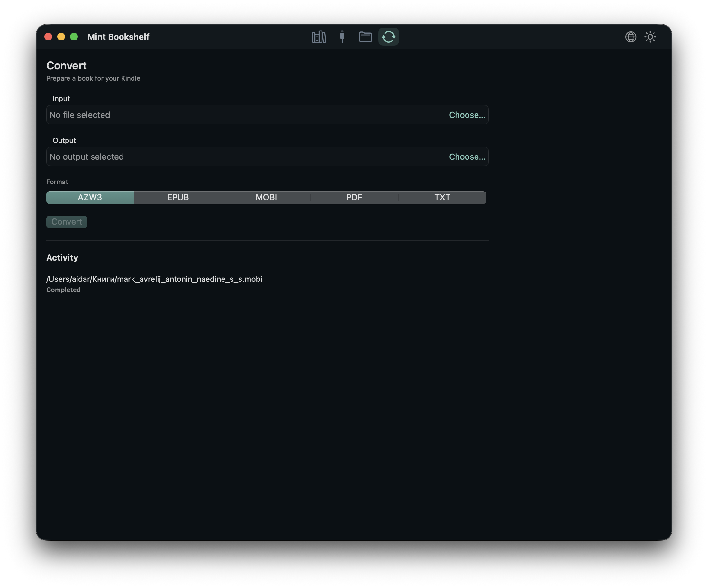

<div align="center">
  
  <h1>Mint Bookshelf</h1>
  <p><strong>Un écrin natif macOS pour votre bibliothèque et vos Kindle en USB.</strong></p>

  <p>
    <a href="README.md">English</a> ·
    <a href="README.ru.md">Русский</a> ·
    <a href="README.es.md">Español</a> ·
    <a href="README.pt.md">Português</a> ·
    <a href="README.zh.md">中文</a> ·
    <a href="README.fr.md">Français</a>
  </p>

  <p>
    <a href="../../releases"></a>
    
    
    
    
    
  </p>
</div>

> **Bibliothèque locale. Accès USB direct. Sans cloud ni superflu.**
>
> Mint Bookshelf réunit vos livres, votre Kindle et le travail quotidien sur les fichiers dans une seule application macOS.

## Fonctions

| Bibliothèque | Kindle | Fichiers |
| --- | --- | --- |
| Couvertures, recherche, détails et tri par titre, auteur ou date d’ajout. | Arborescence MTP, envoi, téléchargement, déplacement, copie, renommage et suppression. | Navigateur local façon Finder avec copier, coller, glisser-déposer et opérations en arrière-plan. |

| Conversion | Apparence | Confort |
| --- | --- | --- |
| Conversion avec Calibre, progression et annulation. | Thèmes clair et sombre, six langues d’interface et comportement macOS natif. | Sans barres d’actions : menus contextuels, raccourcis et une séparation nette entre liste et détails. |

## Captures

<div align="center">
  <table>
    <tr>
      <td width="50%" align="center">
        <br>
        <sub>Bibliothèque — thème clair</sub>
      </td>
      <td width="50%" align="center">
        <br>
        <sub>Bibliothèque — thème sombre</sub>
      </td>
    </tr>
    <tr>
      <td width="50%" align="center">
        <br>
        <sub>Navigateur Kindle</sub>
      </td>
      <td width="50%" align="center">
        <br>
        <sub>Conversion avec Calibre</sub>
      </td>
    </tr>
  </table>
</div>

## Ce que fait l’application

- Analyse uniquement le dossier choisi et le mémorise entre les lancements.
- Extrait les couvertures EPUB, MOBI, AZW, AZW3, PDF et FB2 ; crée une couverture sobre si elle manque.
- Recherche par titre, auteur et série ; trie par titre, auteur ou date d’ajout.
- Affiche le Kindle comme une arborescence et transfère les fichiers avec une progression en octets.
- Convertit les livres avec Calibre et suit les tâches dans l’activité.
- Bascule à tout moment entre **anglais, russe, espagnol, portugais, chinois et français**.

## Kindle compatibles

Mint Bookshelf prend en charge les **Kindle modernes en MTP** via libmtp.

- Vérifié sur **Kindle Scribe** et les modèles actuels de 2025.
- Compatible avec Kindle Scribe, Paperwhite 5/Signature, Kindle 11e génération et suivants, Colorsoft et les modèles 2024–2025.
- **Non compatible :** les anciens Kindle en USB mass storage, dont le Kindle Paperwhite 2 (DP75SDI, 2013–2014).

> Une seule session MTP doit être ouverte. Fermez les autres outils MTP avant d’utiliser l’onglet Kindle.

## Installation

1. Ouvrez la page [Releases](../../releases).
2. Téléchargez `MintBookshelf-<version>.dmg`.
3. Ouvrez le DMG et glissez **Mint Bookshelf** dans **Applications**.

La version actuelle cible **Apple Silicon** et est signée ad-hoc. Si macOS bloque le premier lancement, faites un clic droit sur l’app et choisissez **Ouvrir**.

Le DMG inclut `libmtp` et `libusb` ; Homebrew n’est pas nécessaire pour lancer l’application.

## Compilation

Prérequis : macOS 14+, Xcode, Go, Homebrew, `pkg-config`, `libmtp` et `libusb`.

```sh
brew install pkg-config libmtp libusb
make check-deps
make package
make dmg
```

L’application est créée dans `macos/Mint Bookshelf.app`, le DMG dans `build/MintBookshelf.dmg`.

## Releases

Les releases sont créées par GitHub Actions :

```sh
git tag v0.1.0
git push origin v0.1.0
```

Le workflow **Release** exécute les tests Go et Swift, inscrit la version, construit le DMG, le vérifie, génère le SHA-256 et publie les deux fichiers dans **Releases**. Il peut aussi être lancé manuellement via **Actions → Release → Run workflow**.

## Architecture

- **SwiftUI**, Swift 6, macOS 14+
- **Cœur Go** sous forme de `libkindlecore.dylib`, ABI C et JSON
- **libmtp/libusb** pour l’accès au Kindle
- **SQLite** pour la bibliothèque et l’historique
- **Calibre CLI** pour la conversion optionnelle

## Tests

```sh
go test ./...
make test-race
DEVELOPER_DIR=/Applications/Xcode.app/Contents/Developer swift test --package-path macos
```

## Localisation

L’interface est traduite en anglais, russe, espagnol, portugais, chinois simplifié et français. La langue se choisit dans le menu en haut à droite et est mémorisée ; par défaut, elle suit le système.

Ajouter une langue est simple :

1. Ajoutez un `case` et le nom dans `AppLanguage`, dans `macos/Sources/MintBookshelf/Localization.swift`.
2. Créez un dictionnaire, par exemple `Localization+German.swift`.
3. Enregistrez-le dans `L10n.tables`.

Toutes les chaînes, statuts, compteurs et erreurs utilisent l’API commune `L10n`.

## Remarques

- Seuls les Kindle modernes en MTP sont pris en charge ; l’USB mass storage ne l’est pas.
- Plusieurs appareils Amazon peuvent être sélectionnés ; la détection et la reconnexion sont régulières.
- La suppression sur l’appareil est définitive et demande confirmation.
- L’application garde une session MTP ouverte pendant toute son exécution.
- `docs/` contient des notes locales de recherche et de compilation.

## Licence

MIT. Voir [LICENSE](LICENSE).
