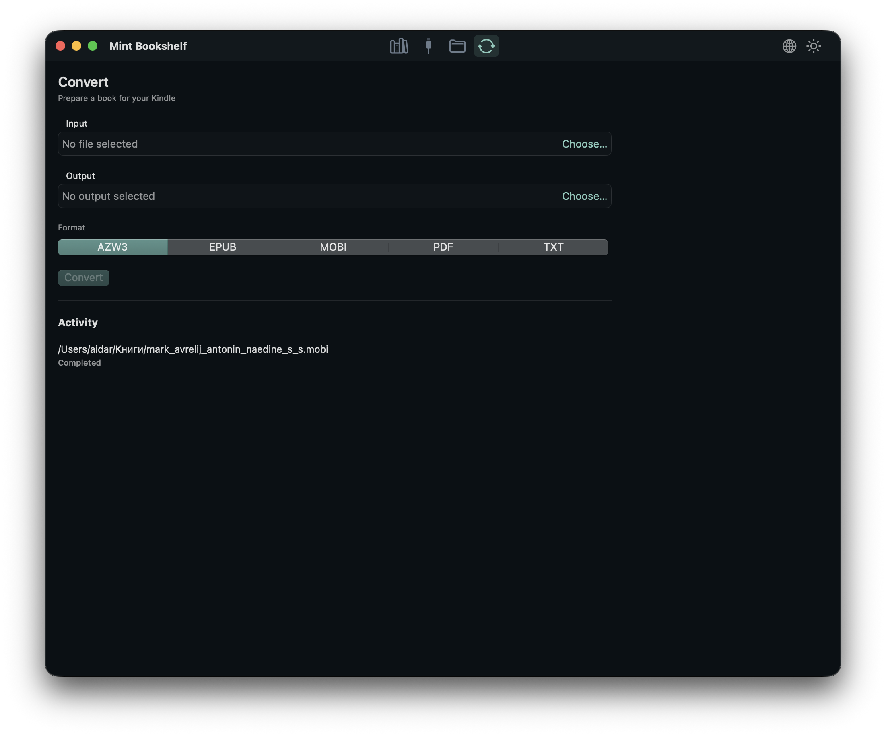

<div align="center">
  
  <h1>Mint Bookshelf</h1>
  <p><strong>A native macOS home for your e-book library and USB Kindles.</strong></p>

  <p>
    <a href="README.md">English</a> ·
    <a href="README.ru.md">Русский</a> ·
    <a href="README.es.md">Español</a> ·
    <a href="README.pt.md">Português</a> ·
    <a href="README.zh.md">中文</a> ·
    <a href="README.fr.md">Français</a>
  </p>

  <p>
    <a href="../../releases"></a>
    
    
    
    
    
  </p>
</div>

> **Local library. Direct USB access. No cloud, no clutter.**
>
> Mint Bookshelf brings your books, your Kindle, and everyday file work into one focused macOS app.

## Highlights

| Browse your library | Work with your Kindle | Move files without friction |
| --- | --- | --- |
| Folder-first library with covers, search, details, and sorting by title, author, or date added. | MTP device browser with folder tree, upload, download, move, copy, rename, and delete. | Finder-style local browser with copy, cut, paste, drag-in, drag-out, and background transfers. |

| Convert and prepare | Make it yours | Built to stay out of the way |
| --- | --- | --- |
| Calibre-powered conversion with inline activity, progress, and cancellation. | Dark and light themes, six UI languages, native macOS window behavior. | No action bars or noisy panels. Context menus, keyboard shortcuts, and a clean split view. |

## Screenshots

<div align="center">
  <table>
    <tr>
      <td width="50%" align="center">
        <br>
        <sub>Library — light theme</sub>
      </td>
      <td width="50%" align="center">
        <br>
        <sub>Library — dark theme</sub>
      </td>
    </tr>
    <tr>
      <td width="50%" align="center">
        <br>
        <sub>Kindle device browser</sub>
      </td>
      <td width="50%" align="center">
        <br>
        <sub>Calibre-powered conversion</sub>
      </td>
    </tr>
  </table>
</div>

## What it does

- Library scans only the folder you choose and remembers it between launches.
- Covers are extracted from EPUB, MOBI, AZW, AZW3, PDF, and FB2; missing covers get a generated fallback.
- Search across titles, authors, and series; sort by title, author, or date added.
- Browse Kindle storage as a folder tree and transfer files with byte-level progress.
- Convert books with Calibre and follow conversion tasks in the activity list.
- Use the local Finder-style browser for drag-and-drop workflows.
- Switch between **English, Russian, Spanish, Portuguese, Chinese, and French** at any time.

## Supported Kindles

Mint Bookshelf supports **modern MTP Kindles** through libmtp.

- Verified on **Kindle Scribe** and current 2025 Kindle models.
- Expected to work with Kindle Scribe, Paperwhite 5/Signature, Kindle 11th generation and newer, Colorsoft, and current 2024–2025 models.
- **Not supported:** older USB mass-storage Kindles, including Kindle Paperwhite 2 (DP75SDI, 2013–2014).

> Only one MTP session should be open at a time. Close other MTP tools before using the Kindle tab.

## Install

1. Open the [Releases](../../releases) page.
2. Download `MintBookshelf-<version>.dmg`.
3. Open the DMG and drag **Mint Bookshelf** into **Applications**.

The current release build targets **Apple Silicon** and is ad-hoc signed. If macOS blocks the first launch, right-click the app and choose **Open**.

The DMG bundles `libmtp` and `libusb`, so Homebrew is not required to run the app.

## Build

Requirements: macOS 14+, Xcode, Go, Homebrew, `pkg-config`, `libmtp`, and `libusb`.

```sh
brew install pkg-config libmtp libusb
make check-deps
make package
make dmg
```

The packaged app is written to `macos/Mint Bookshelf.app`; the disk image is created at `build/MintBookshelf.dmg`.

## Release

Releases are built by GitHub Actions:

```sh
git tag v0.1.0
git push origin v0.1.0
```

The **Release** workflow runs the Go and Swift tests, stamps the version, builds the DMG, verifies it, creates a SHA-256 checksum, and publishes both files under **Releases**. You can also run it manually from **Actions → Release → Run workflow**.

## Architecture

- **SwiftUI** front end, Swift 6, macOS 14+
- **Go core** compiled as `libkindlecore.dylib`, called through a C ABI with JSON
- **libmtp/libusb** for Kindle access
- **SQLite** for the local library and operation history
- **Calibre CLI** for optional conversion

## Tests

```sh
go test ./...
make test-race
DEVELOPER_DIR=/Applications/Xcode.app/Contents/Developer swift test --package-path macos
```

## Localization

The interface is fully localized into English, Russian, Spanish, Portuguese, Simplified Chinese, and French. Language is selected from the top-right menu and restored on the next launch; the default follows the system locale.

Adding a language is intentionally a small change:

1. Add a case and display name to `AppLanguage` in `macos/Sources/MintBookshelf/Localization.swift`.
2. Create one dictionary file, for example `Localization+German.swift`.
3. Register it in `L10n.tables`.

All UI strings, statuses, counts, and errors use the shared `L10n` API.

## Notes

- Only modern MTP Kindles are supported; USB mass-storage Kindles are not.
- Multiple Amazon devices can be selected; discovery and reconnect are polled.
- Device deletion is permanent and requires confirmation.
- The app keeps one MTP session open for its lifetime.
- `docs/` contains local-only research and build notes.

## License

MIT. See [LICENSE](LICENSE).
