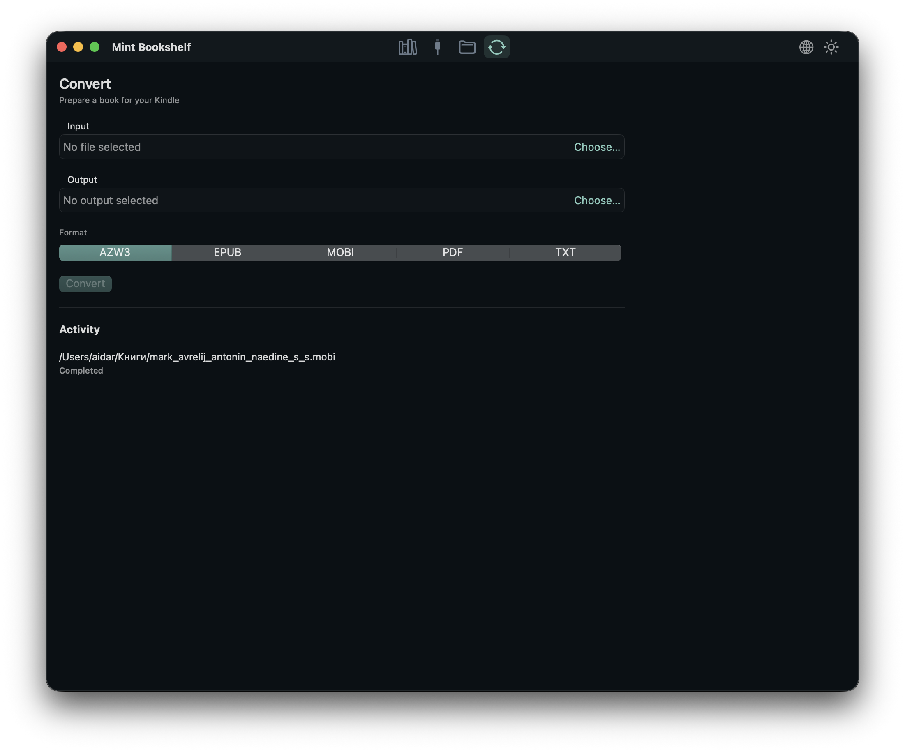

<div align="center">
  
  <h1>Mint Bookshelf</h1>
  <p><strong>Um lar nativo no macOS para sua biblioteca e seus Kindles via USB.</strong></p>

  <p>
    <a href="README.md">English</a> ·
    <a href="README.ru.md">Русский</a> ·
    <a href="README.es.md">Español</a> ·
    <a href="README.pt.md">Português</a> ·
    <a href="README.zh.md">中文</a> ·
    <a href="README.fr.md">Français</a>
  </p>

  <p>
    <a href="../../releases"></a>
    
    
    
    
    
  </p>
</div>

> **Biblioteca local. Acesso USB direto. Sem nuvem e sem excesso.**
>
> O Mint Bookshelf reúne seus livros, seu Kindle e o trabalho diário com arquivos em um único aplicativo para macOS.

## Recursos

- **Biblioteca** — capas, busca, detalhes e ordenação por título, autor ou data de adição.
- **Kindle** — árvore de pastas MTP, envio, download, movimentação, cópia, renomeação e exclusão.
- **Arquivos** — navegador local no estilo Finder com copiar, colar, arrastar e operações em segundo plano.
- **Conversão** — com Calibre, progresso e cancelamento.
- **Aparência** — temas claro e escuro, seis idiomas de interface e comportamento nativo do macOS.
- **Praticidade** — sem barras de ações: menus de contexto, atalhos e uma divisão limpa entre lista e detalhes.

## Capturas

<div align="center">
  
  <br>
  <sub>Biblioteca — temas claro e escuro</sub>
</div>

## O que faz

- Analisa apenas a pasta escolhida e lembra dela entre execuções.
- Extrai capas de EPUB, MOBI, AZW, AZW3, PDF e FB2; quando não há capa, gera uma capa limpa.
- Busca por título, autor e série; ordena por título, autor ou data de adição.
- Mostra o Kindle como árvore de pastas e transfere arquivos com progresso em bytes.
- Converte livros com Calibre e acompanha as tarefas na atividade.
- Alterna entre **inglês, russo, espanhol, português, chinês e francês** a qualquer momento.

<div align="center">
  <br>
  <sub>Conversão com Calibre</sub>
</div>

## Kindles compatíveis

O Mint Bookshelf oferece suporte a **Kindles modernos com MTP** via libmtp, além
de **Kindles antigos com USB mass storage** que o macOS monta como unidade.

- Verificado no **Kindle Scribe** e em modelos atuais de 2025.
- Compatível com Kindle Scribe, Paperwhite 5/Signature, Kindle 11ª geração e posteriores, Colorsoft e modelos 2024–2025.
- Kindles com USB mass storage (incluindo **Kindle Oasis de 10ª geração**, Kindle Paperwhite 2 / DP75SDI e outros modelos anteriores a 2024) aparecem automaticamente na aba Kindle quando o macOS os monta como volume.

<div align="center">
  <br>
  <sub>Navegador do Kindle</sub>
</div>

> Apenas uma sessão MTP deve ficar aberta. Feche outras ferramentas MTP antes de usar a aba Kindle.

## Instalação

1. Abra a página de [Releases](../../releases).
2. Baixe `MintBookshelf-<versão>.dmg`.
3. Abra o DMG e arraste **Mint Bookshelf** para **Applications**.

A compilação atual é para **Apple Silicon** e assinada ad-hoc. Se o macOS bloquear a primeira abertura, clique com o botão direito no app e escolha **Abrir**.

O DMG inclui `libmtp` e `libusb`, então o Homebrew não é necessário para executar o app.

## Compilação

Requisitos: macOS 14+, Xcode, Go, Homebrew, `pkg-config`, `libmtp` e `libusb`.

```sh
brew install pkg-config libmtp libusb
make check-deps
make package
make dmg
```

O app fica em `macos/Mint Bookshelf.app` e o DMG em `build/MintBookshelf.dmg`.

## Releases

Os releases são criados pelo GitHub Actions:

```sh
git tag v0.1.0
git push origin v0.1.0
```

O workflow **Release** executa os testes de Go e Swift, define a versão, cria o DMG, verifica o arquivo, gera o SHA-256 e publica os dois arquivos em **Releases**. Também é possível executar manualmente em **Actions → Release → Run workflow**.

## Arquitetura

- **SwiftUI**, Swift 6, macOS 14+
- **Núcleo em Go** como `libkindlecore.dylib`, com ABI C e JSON
- **libmtp/libusb** para acesso ao Kindle
- **SQLite** para a biblioteca e o histórico
- **Calibre CLI** para conversão opcional

## Testes

```sh
go test ./...
make test-race
DEVELOPER_DIR=/Applications/Xcode.app/Contents/Developer swift test --package-path macos
```

## Localização

A interface está traduzida para inglês, russo, espanhol, português, chinês simplificado e francês. O idioma é escolhido no menu superior direito e lembrado; por padrão, segue o sistema.

Adicionar um idioma é simples:

1. Adicione um `case` e o nome em `AppLanguage`, em `macos/Sources/MintBookshelf/Localization.swift`.
2. Crie um dicionário, por exemplo `Localization+German.swift`.
3. Registre-o em `L10n.tables`.

Todas as strings, status, contadores e erros usam a API comum `L10n`.

## Observações

- Kindles modernos com MTP usam libmtp; Kindles antigos com USB mass storage são navegados pelo volume montado.
- Vários dispositivos Amazon podem ser selecionados; descoberta e reconexão são periódicas.
- A exclusão no dispositivo é permanente e exige confirmação.
- O app mantém uma sessão MTP aberta durante toda a execução.
- `docs/` contém notas locais de pesquisa e compilação.

## Licença

MIT. Veja [LICENSE](LICENSE).
